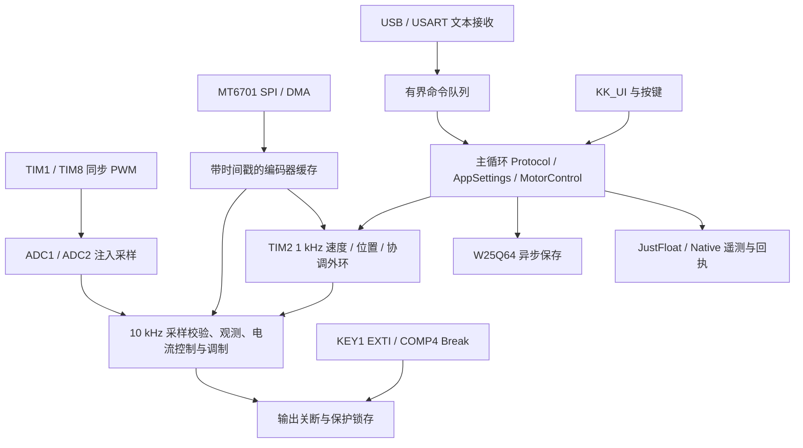

# FOC_two：STM32G431 双无刷电机驱动与调试平台

基于 **STM32G431VBT6** 的双电机控制工程，集成编码器 FOC、M1 独立 HSO 无感、M1 六步无感、双机同步／手动主从、参数辨识、LCD 操作界面和单文件 HTML 上位机。

本文对应当前源码 **`UI-R122-SIZ`**，Native 配置回执的固件编号为 **122**。以 `FOC_two.ioc`、当前应用源码及实际构建产物为配置依据。`docs/` 保存了多轮实现和现场调试记录，其中的版本号、菜单位置、资源余量可能属于历史版本。

> 芯片是 **STM32G431VBT6**，链接容量为 **128 KiB Flash、32 KiB RAM**。当前 Flash 剩余 **448 B**；新增功能前必须重新测量并释放空间。

## 目录

- [1. 功能与支持范围](#features)
- [2. 硬件与外设配置](#hardware)
- [3. 软件结构与实时调度](#architecture)
- [4. 构建、下载与首次运行](#build)
- [5. LCD、按键与设置操作](#ui)
- [6. 控制方式与电机参数](#control)
- [7. 电机参数辨识与应用](#identification)
- [8. 保护、故障与诊断](#protection)
- [9. 通信接口与文本命令](#commands)
- [10. App 设置／动作接口](#app-api)
- [11. 标准 JustFloat 协议](#justfloat)
- [12. Native 二进制协议](#native)
- [13. 单文件 HTML 上位机](#console)
- [14. 掉电保存与共享 SPI2](#storage)
- [15. 测试与开发约定](#development)
- [16. 常见问题](#faq)
- [17. 文档索引与许可](#references)

<a id="features"></a>

## 1. 功能与支持范围

### 1.1 驱动能力

| 工作模式 | M1 | M2 | 可用控制 |
| --- | --- | --- | --- |
| `SingleM1` | 编码器 FOC／HSO／六步无感，三者互斥 | 不参与运动 | FOC：Torque、Speed、Position；HSO：Speed；六步预设：Speed、Throttle；ESC：Throttle |
| `SingleM2` | 不参与运动 | MT6701 编码器 FOC | Torque、Speed、Position |
| `Independent` | 编码器 FOC | 编码器 FOC | 两轴分别设目标、运行、停止 |
| `SyncSpeed` | 编码器 FOC | 编码器 FOC | 共同速度轨迹，按比例联动 |
| `SyncPosition` | 编码器 FOC | 编码器 FOC | 共同位置轨迹，比例／偏移联动 |
| `MasterM1` | 手动主轴，功率输出关闭 | 位置跟随从轴 | 手转 M1，M2 跟随 |
| `MasterM2` | 位置跟随从轴 | 手动主轴，功率输出关闭 | 手转 M2，M1 跟随 |

**M2 以及全部双机模式只使用编码器反馈。** 两台电机可以选择不同型号。M1 的 HSO 和六步无需编码器参与正常无感启动，但参数辨识仍需 ENC1。

### 1.2 已集成功能

- 10 kHz 双轴电流采样和快速控制，1 kHz 速度／位置外环。
- MT6701 SSI 帧校验、采样时间戳、速度估计、合法零码连续性判断、DMA 超时恢复和 E1／E2 分轴诊断。
- FOC 电流 PI、dq 电压矢量限幅和积分回算；编码器路径的模型前馈与时序补偿。HSO 保留纯电流 PI 路径，不启用此前引起震动的模型电压前馈。
- M1 HSO：限流对齐、I/F 起转、未知磁链估算、捕获资格判断、无扰接管及失锁停机。
- M1 六步：I/F 启动、反电势过零检测、定时换相、ON／OFF 采样切换、Speed／Throttle 和 ESC 通用参数模式。
- M1 参数辨识：极对数／编码器方向、等效星形 Rs、等效 Ls、磁链与反电动势常数。
- 2804／4015 预设、每轴测量参数覆盖、三个共享 Custom 电机槽位。
- ST7735S 160×80 横屏、KK_UI 菜单／动画／编辑器、按键消抖与长按连加减、WS2812 状态灯。
- W25Q64 异步保存、A/B 设置记录、CRC、旧版本迁移和事件日志。
- KEY1 全局停止、M1 COMP4→TIM1 Break 硬件 IBUS 保护、相电流／过载／采样／编码器／HSO／六步／实时超期保护。
- USB CDC 与 USART1 共用命令和发送格式；上电默认标准 JustFloat，支持 Native 查询／回执／诊断。
- 离线单 HTML 控制台：模式和驱动设置、Run、辨识、诊断、可分配 XY 画布、实时拖动缩放、CSV 记录／回放和配置导入导出。

FDCAN1、I2C3 虽已有初始化，但当前没有与 USB／USART 等价的电机业务通信协议；不要把初始化存在理解成已完成对应上位机功能。

<a id="hardware"></a>

## 2. 硬件与外设配置

### 2.1 当前配置概览

| 项目 | 当前配置／用途 |
| --- | --- |
| MCU | STM32G431VBT6，Cortex-M4F，170 MHz |
| 存储布局 | 内部 Flash 128 KiB；链接器 RAM 区 32 KiB；外部 W25Q64 存设置与日志 |
| 系统与总线 | SYSCLK／HCLK／APB1／APB2 均为 170 MHz |
| M1 PWM | TIM1，中心对齐，PSC=0、ARR=8499，10 kHz，三相互补输出 |
| M2 PWM | TIM8，同频；TIM1 主触发、TIM8 ITR0 Trigger 从模式实现同步启动 |
| MCU 死区 | 当前 TIM1／TIM8 DeadTime=17；这是 MCU 配置值，不等于包含栅极驱动内部延迟的实测总死区 |
| 快速采样 | ADC1／ADC2 注入同时模式，TIM1 TRGO2 触发；ADC1 完整序列 IRQ 组织双轴控制 |
| ADC 时钟 | 同步 PCLK /4，42.5 MHz，12 位、右对齐 |
| 低速采样 | ADC1 规则组 `[VBUS, VREFINT]`，DMA 循环；应用在合适的注入采样之后调度 TIM6 TRGO，名义 2 kHz |
| 外环 | TIM2，PSC=169、ARR=999，1 kHz |
| 六步换相 | 应用管理的 TIM7 单次定时器，用于换相与过零丢失监督 |
| 编码器 | M1／M2 各一颗 MT6701，SPI1／SPI2，3 字节 SSI：14 位角度、4 位状态、6 位 CRC |
| 相电流前端 | INA240A2，增益 50 V/V，0.01 Ω 相线分流；REF1=AGND、REF2=模拟参考电源 |
| M1 IBUS 前端 | INA240A2、5 mΩ，COMP4 正输入；DAC3 CH2 提供负输入阈值 |
| LCD | ST7735S，原生 80×160；旋转为 160×80 横屏，SPI3 刷新 |
| 状态灯 | 单颗 WS2812，TIM3 CH1 与生成的 CC1 DMA 链接 |
| USB | USB FS CDC，HSI48／CRS，PCD 单缓冲，LPM 关闭 |
| 串口 | USART1，115200 bit/s、8 数据位、无校验、1 停止位、无硬件流控 |

TIM6 并非简单地完全自由运行后随意抢占注入组：应用保留 STM32G431 注入／规则组并用时的调度约束。改变 PWM 频率、ADC Rank 或触发来源，需要同时适配算法，不能只修改 CubeMX 后忽略构建检查。

### 2.2 主要引脚

| 信号 | 引脚／外设 |
| --- | --- |
| M1 U/V/W 高侧 PWM | PE9／PE11／PE13，TIM1 CH1／CH2／CH3 |
| M1 U/V/W 低侧 PWM | PE8／PE10／PE12，TIM1 CH1N／CH2N／CH3N |
| M2 U/V/W 高侧 PWM | PC6／PC7／PC8，TIM8 CH1／CH2／CH3 |
| M2 U/V/W 低侧 PWM | PB3／PB4／PB5，TIM8 CH1N／CH2N／CH3N |
| ENC1 SCK／MISO／MOSI／CS | PA5／PA6／PA7／PA4，SPI1 |
| ENC2 SCK／MISO／MOSI／CS | PB13／PB14／PB15／PB12，SPI2 |
| W25Q64 CS | PD15；与 ENC2 共用 SPI2 总线 |
| LCD SCK／MISO／MOSI | PC10／PC11／PC12，SPI3；具体读写能力以显示驱动为准 |
| LCD CS／DC／RESET | PA15／PD2／PD3 |
| USART1 TX／RX | PA9／PA10，3.3 V MCU 逻辑；不直接连接 RS-232 电平 |
| USB D−／D+ | PA11／PA12 |
| 上／右／下／左／OK | PD8／PD9／PD10／PD11／PD12 |
| KEY1 全局停止 | PD13，下降沿 EXTI，低有效、内部上拉 |
| KEY2 返回 | PD14，低有效 |
| WS2812 数据 | PE2，TIM3 CH1 |
| M1 IBUS 比较器输入 | PE7，COMP4_INP；负输入内部接 DAC3 CH2 |
| SWD | PA13／PA14 |
| 其他已初始化接口 | FDCAN1 PD0／PD1；I2C3 PA8／PC9 |

以上是当前生成配置的记录，不是用户驱动允许写死的映射。修改引脚／DMA 后仍由 CubeMX 管理，详见 [开发约定](#development)。

### 2.3 ADC 通道与采样顺序

当前源码的 Rank 分配如下，**与项目早期的推荐分配图并不相同**：

| 注入 Rank | ADC1 | ADC2 | 当前采样周期 |
| --- | --- | --- | --- |
| 1 | PA0 / IN1：M1 IU | PA1 / IN2：M1 IV | 12.5 / 12.5 |
| 2 | PC0 / IN6：M1 IW | PC2 / IN8：M1 V 相端电压 | 47.5 / 47.5 |
| 3 | PC1 / IN7：M1 U 相端电压 | PC3 / IN9：M1 W 相端电压 | 47.5 / 47.5 |
| 4 | PB11 / IN14：M2 IU | PC4 / IN5：M2 IV | 12.5 / 12.5 |

| ADC1 规则 Rank | 信号 | 采样周期 |
| --- | --- | --- |
| 1 | PB0 / IN15：VBUS | 47.5 |
| 2 | 内部 VREFINT | 640.5 |

M2 的 W 相电流由 `IW = −IU − IV` 重建。两 ADC 的同 Rank 同时采样，不代表不同 Rank 之间没有时间差。HSO 适配包含相电压前端与 Rank 时差的处理。

### 2.4 电压和电流换算

使用出厂 VREFINT 标定值估计有效 ADC 参考电压，再做 64 次平均和一阶低通：

```text
VREF_est ≈ VREFINT_CAL × Vcal / mean(ADC_VREFINT)
VREF_filtered ← VREF_filtered + 0.125 × (VREF_est − VREF_filtered)
ADC_LSB = VREF_filtered / 4095

相电流 I = (ADC_raw − ADC_zero) × ADC_LSB / (0.01 Ω × 50)
母线／相端电压 V = ADC_raw × ADC_LSB × 11
```

`Vcal` 取芯片头文件的出厂标定电压宏。估算的是 **ADC 实际使用的 VREF+ 对 VREF− 电压**；只有 VREF+ 与 VDDA、INA240 参考确实共轨时，才可把它作为该共用参考轨的近似值。它不是一次独立测量所有 3.3 V 节点的结果。

电流零点启动时采集 2000 帧。母线未接入时持续采样，不因检测到 0 V 永久停止；母线有效并稳定约 100 ms 后才开始收集零点。参考数据未就绪／过期时不允许请求功率输出。

当前分压为 `(10 kΩ + 10 kΩ) : 2 kΩ`，比值 11。参考 3.26 V 时理想 ADC 满量程约 **35.86 V**，须留硬件余量；不能因为电机铭牌支持 36～40 V，就认为本采样电路适用于该电压。

详见 [ADC 核查](docs/ADC_dual_motor_review.md)、[VREFINT 跟踪](docs/VREFINT_reference_tracking.md)、[逆变器时序](docs/Inverter_timing_R114.md)。

<a id="architecture"></a>

## 3. 软件结构与实时调度

工程采用裸机主循环与中断，不依赖 RTOS。外设初始化来自 CubeMX，运行时选用 HAL 与用户 LL 驱动混合实现。



| 模块 | 职责 |
| --- | --- |
| `Core/`、`.ioc` | 生成的时钟、引脚、外设、DMA／NVIC 初始化与向量入口 |
| `mycode/motor_control.*` | 工作模式、驱动互斥、双轴命令准入、来源所有权、同步／Follow、故障联动 |
| `mycode/JerryFOC.*` | M1 FOC、公共控制器／坐标变换／调制、电流 PI 与外环 |
| `mycode/motor_sampling.*` | 成对 ADC 帧、电流零点、VREF／VBUS、换算、相电流／过载与 IBUS／全局停止门控 |
| `mycode/motor_irq.*`、`cubemx_irq.h` | 精简 IRQ 分发，连接生成向量与用户运行时驱动 |
| `mycode/MT6701.*`、`angle_src_encoder.*`、`encoder_estimator.*` | 双编码器 SSI、DMA、健康／连续性、角度和速度估计 |
| `mycode/st_hso.*`、`st_hso_port/` | ST HSO 官方库外围接口、独立启动、磁链估算、资格与失锁处理 |
| `mycode/motor_sixstep.*` | 六步起转、真实过零、定时换相、速度／油门控制 |
| `mycode/motor_detect.*`、`motor_params.*` | 参数辨识、预设／Custom／已应用参数、控制阈值 |
| `mycode/app_settings.*`、`app_control.h` | 设置校验、发布、保存调度与应用层公共接口 |
| `mycode/ui_app.*`、`ui_input.*`、`ui_text.*` | 产品菜单、Run／辨识页、远程页面同步、按键与文本格式化 |
| `mycode/protocol.*`、`number_parse.*` | 两路命令、RPC、遥测格式与严格数值解析 |
| `mycode/spi_port.*`、`uart_port.*`、`ws2812.*` | 用户运行时 LL 收发、恢复与状态灯 |
| `mycode/app_storage.*`、`w25q64.*` | 设置／日志、A/B 保存、SPI2 Flash 访问 |
| `mycode/board_diag.*` | CPU／首次故障记录、实时统计、外环超期监督 |
| `mycode/kk_ui/`、`kk_oled/` | UI 框架与绘图／显示驱动 |

接收中断不执行普通设置业务或生成遥测文本。主循环执行有界队列、Flash 保存和 UI；`Stop` 使用优先停止路径。控制 ISR 不应加入日志格式化、阻塞 SPI／Flash 操作或不受限循环。

<a id="build"></a>

## 4. 构建、下载与首次运行

### 4.1 工具

- CMake **3.22 或更新版本**、Ninja、Python 3。
- `arm-none-eabi-gcc` 工具链，支持项目使用的 `-Oz`、LTO、Cortex-M4F hard-float；当前构建环境为 STM32CubeCLT 的 GCC 13.3.1。
- STM32CubeMX，用于打开和重新生成 `FOC_two.ioc`。
- ST-Link 及配套下载／调试工具。已有 VS Code STM32 调试配置见 `.vscode/launch.json`。
- 主机 C 测试另需本机 `gcc`；上位机前端测试需 Node.js；浏览器与 ARM 仿真测试还有独立依赖，见各测试脚本。

确认工具在 PATH 中后，在仓库根目录执行：

```powershell
cmake --preset Debug
cmake --build --preset Debug

cmake --preset Release
cmake --build --preset Release
```

每次正常构建都会运行 `scripts/check_cubemx.py`。失败时先看错误指明的配置与适配点，不能绕过检查强行运行。

输出：

```text
build/Debug/FOC_two.elf
build/Debug/FOC_two.bin
build/Debug/FOC_two.map
build/Release/FOC_two.elf
build/Release/FOC_two.bin
build/Release/FOC_two.map
```

构建完成同步生成 BIN。使用 ST-Link 下载 ELF，或将 BIN 写入 **`0x08000000`**；确保使用刚构建的对应配置。Debug 保留符号，但多处使用 `-Os`／`-Oz`／LTO，局部变量出现 `optimized out` 属于优化后的调试表现。HSO 热路径保持 `-O2`。

### 4.2 当前资源快照

下表为 R122 当前工具链的链接结果，不是所有工具链通用的固定值：

| 配置 | Flash 镜像占用 | Flash 剩余 | RAM 总分配 | RAM 区剩余 |
| --- | ---: | ---: | ---: | ---: |
| Debug | 130624 B | 448 B | 30920 B | 1848 B |
| Release | 130624 B | 448 B | 30920 B | 1848 B |

R120 的诊断格式化与命令解析优化净回收 212 B，分阶段测量和回归见 [R120 体积优化](docs/Flash_cold_R120.md)。

R121 继续优化 Run／Follow／Detect 绘制和输入，净回收 112 B，第 1～3 项累计回收 324 B。画面及交互对照见 [R121 UI 体积优化](docs/UI_size_R121.md)。

R122 调整低频用户函数的编译属性，净回收 112 B，第 1～4 项累计回收 436 B。保留的属性、撤回试验和验证见 [R122 编译策略实测](docs/Cold_compile_R122.md)。

RAM 数字包含链接器预留的 512 B 堆、2048 B 栈及保留诊断区；不是运行时栈高水位。ELF 文件还含调试信息，其磁盘大小不等于 MCU Flash 占用。`arm-none-eabi-size` 的段合计与连续 BIN 长度可能因对齐略有不同。

`.gitignore` 保留标准 Debug／Release 目录中的 ELF／BIN／MAP 作为备份，忽略对象文件、缓存与主机测试产物。

### 4.3 首次运行

1. 核对当前电机供电、相电流前端、UVW 相序、编码器供电／磁铁位置和急停按键。正确选择电机型号；首次验证使用限流电源、空载与较小目标。
2. 上电先采样／检查参考、母线和电流零点。有感模式满足条件后自动请求约 3 s 对齐；双机按顺序进行，手动主从中的被动主轴不会通电对齐。
3. 在 `About` 核对 FW，在 `Status → Drive / ADC / Encoder` 查看 VBUS、VREF、Drive、Aligned 和对应 E1／E2。
4. `NOT ALIGNED` 时在 Run 按 OK 或发送 `Align:M1`／`Align:M2` 申请对齐。对齐完成后再次明确确认才运行，不自动把旧草稿作为运动指令。
5. 单轴确认方向、反馈、停止正常后，再验证双独立、同步或 Follow。
6. 本地 KEY1 或上位机全局暂停触发 `GLOBAL STOP` 后，释放实体按键并等待释放保护，再显式发起允许的对齐／运行。通信恢复、编码器重连不会自动复转。

未接母线时可以先给 MCU 上电；VBUS 为 0 只会阻止输出准入，后台仍继续检测。若 MCU 卡在 `Error_Handler()`，检查 `g_boot_stage`、`g_error_return_address` 和生成初始化返回值，不能只跳过错误处理。

<a id="ui"></a>

## 5. LCD、按键与设置操作

首页包含 Run、Settings、Status、About；首页左右选择有过渡动画。主要设置组织为：

```text
Settings
├─ System
│  ├─ Work Mode：7 种工作模式
│  ├─ Axis M1 / Axis M2
│  ├─ Sensorless：HSO Feedback / Six Step
│  ├─ Gear Ratio / Gear Offset
│  ├─ Align Retry / Clear diag
│  └─ TX Format：JustFloat / Native，仅本次上电有效
├─ Curr Loop
├─ Pos Speed / Speed Limit
├─ Run Steps
├─ M1 Protection：IBUS 阈值、清除 IBUS 锁存
├─ Motor：2804 / 4015 / ESC Auto / 有效 Custom 槽，以及 M1 Detect
├─ Status LED / LED Bright
├─ 保存状态
└─ Reset

Status
├─ Drive / Motion / Encoder / ADC
├─ HSO / Six Step
├─ Diagnostics
└─ Axis M1 / Axis M2
```

实际菜单会按工作模式、驱动和有效 Custom 槽调整。`Axis/View` 是查看与本地编辑对象，不能替代双机通信中的显式轴前缀。

| 场景 | 操作 |
| --- | --- |
| 全局 KEY1 | 独立 EXTI 全局停止，不用于切电机；运行中不等待 UI 消抖或页面刷新 |
| KEY2 | Back；Run 内执行明确停止并返回 |
| 首页 | 左右选择，OK 进入 |
| 菜单／信息页 | 上下按页面滚动；OK 进入／确认；KEY2 返回 |
| Run 上／下 | 当前模式草稿加减，按住支持连续操作 |
| Run 左／右 | 切换允许的控制方式；双独立短按在松手后执行，长按约 600 ms 分别选择 M1／M2 |
| Run OK，数值有变化 | 提交新目标；不会因为当前正在运行而把这次确认解释为停止 |
| Run OK，数值无变化 | 启动／停止切换；活动 Follow 再按 OK 停止整组 |
| Run 未对齐 | 第一次明确确认申请对齐；结束后再次确认运行 |
| Run Steps | 上下选择项，左右连加减，OK 提交；返回取消未提交草稿 |
| 参数辨识页 | 左右翻页；检测中 OK 停止；结果页提供保存／应用／恢复预设／保存 Custom 等动作 |

普通 UI 按键消抖为 20 ms，方向键长按重复起始等待为 300 ms，持续按住会按框架策略加速。KEY1 不走普通扫描；当前 100 nF 对地电容、内部上拉的冷启动等待为 30 ms，运行期仍保留立即停机路径。

Run 显示当前轴、驱动／反馈方式、目标／实际、VBUS 和停机原因。HSO 的有效 `Curr Loop` 始终 ON；六步不使用 FOC 的 Curr Loop 选项。

WS2812 按当前启用轴综合显示：红色为采样／反馈／驱动异常，黄色为尚未对齐，绿色待机，蓝色为检测到运动；可关闭或调亮度。它不是单独的“当前输出已使能”指示器，也不再按键时闪白。

<a id="control"></a>

## 6. 控制方式与电机参数

### 6.1 单位与限幅

| 名称 | 本工程含义 |
| --- | --- |
| Speed | 机械角速度 rad/s；`rpm = rad/s × 60 / (2π)`，100 rad/s 约 955 rpm |
| Position／Angle | 机械角度 rad；串口 `Angle` 的具体参考约定见命令表 |
| Pos Speed | 位置运动允许的速度上限，rad/s；范围 1～当前轴 Speed Limit |
| Speed Limit | 可编辑上限 1～600 rad/s，同时受驱动、电机模型和电压能力限制 |
| Torque，Curr Loop ON | Iq 目标，A；不是直接的 N·m |
| Torque，Curr Loop OFF | Uq 目标，V；不是直接的 N·m |
| Throttle | 六步 0～100% 命令；实际 Duty 受起转、自适应、电压和调制限幅影响，不等于输入百分比 |
| ESC 速度 | 电气频率 Hz；没有输入极对数时不声称知道机械 rad/s |

提高 Speed Limit 只扩大允许请求的范围，不会突破电机反电动势、电源电压、电流和驱动算法限制。当前没有提供通用弱磁调速功能。

### 6.2 源码预设

以下是控制软件实际预设，不应与厂家铭牌不同定义的额定值混用：

| 参数 | 2804 | 4015 |
| --- | ---: | ---: |
| 极对数 | 7 | 11 |
| 等效星形 Rs | 2.3 Ω | 1.8 Ω |
| 默认 Ls | 0.86 mH | 1.3 mH，测量定义未明确时作为初值 |
| 默认永磁磁链 | 0，未知／待估算 | 0，未知／待估算 |
| 模型标称母线 | 12 V | 24 V |
| 电流目标上限参数 | 0.5 A | 1.2 A |
| 相电流瞬时过流阈值 | 2.0 A | 2.5 A |
| 过载参考电流／预算 | 0.8 A / 3 s | 1.4 A / 3 s |
| 型号机械速度上限 | 600 rad/s | 600 rad/s |
| 电压模式速度 PI，P/I | 0.05 / 0.5 | 0.1 / 1.0 |
| 电流模式速度 PI，P/I | 0.05 / 0.5 | 0.05 / 0.5 |
| 普通位置环 P | 6 | 6 |

预设在 `mycode/motor_params.c`。电流 PI 按 `Kp = Ls × 250`、`Ki = Rs × 250` 初始化；250 rad/s 是设计参数，不是经过实测确认的闭环带宽。相电流／dq、电源输入电流和铭牌 RMS 电流不是同一种量。

速度／位置／Follow 增益、相电流阈值和过载预算等仍属于源码预设，不提供任意地址写入或通用在线 PID 编辑。板端和上位机可编辑项以 Settings／App 接口为准；IBUS DAC 阈值是明确开放的独立设置。

换型号清除该轴目标、加载对应控制／保护参数并使旧对齐失效。模型更改需要满足停机／静止条件，不清除已有硬件或时序保护锁存。

### 6.3 同步与手动主从

同步模式由两轴共同的速度／位置参考控制，接受带任一轴前缀的相应目标，但作用于整个组；两轴各自保留电流／编码器控制。同步速度的共同目标会按比例折算后的两轴上限约束。

手动主从使用启用 Follow 时捕获的机械位置作为相对锚点：

```text
目标从轴位置 = 从轴启用位置 + offset
             + ratio × (主轴当前多圈机械位置 − 主轴启用位置)
```

默认 ratio=1、offset=0 时，两轴保持相同的相对角位移；不是要求两个编码器的上电绝对读数相等。主轴功率输出关闭，手动运动由编码器读取；从轴使用追赶参考、速度前馈、位置误差修正及型号对应的平滑／保持策略。

`Gear:` 的 ratio 允许 −10～−0.01 或 0.01～10，offset 允许 ±62.83 rad；设置内部以 0.01 量化。负比例用于反向跟随。倍率、从机速度／电流限制、负载和输入动作带宽共同决定可跟随范围；不能靠无限提高 P 消除所有相位滞后。

### 6.4 M1 独立 HSO

推荐流程：选择 `SingleM1` → 选择正确基础／Custom 电机 → `Feedback:HSO` → 等待采样与静止准入 → 发送非零 Speed。

```text
ALIGN → I/F RAMP → 磁链估算（未知时）→ CAPTURE → CONTROL
```

- 启动与捕获角差来自 I/F／观测器关系；CONTROL 的误差诊断来自观测角连续性，**不依赖编码器做 error 估算**。
- 当前 HSO 只提供速度控制。`CONTROL` 才表示已接管，`TRACKING`／资格累计本身不等于已用无感输出。
- Curr Loop 有效值强制 ON；编码器 FOC 的模型电压前馈不应用到 HSO。
- 非零目标至少满足 5 电气 Hz，再向上取整到 5 rad/s 的整数倍；2804 和 4015 当前命令下限均为 5 rad/s。还受 `<400 电气 Hz` 和 Speed Limit 限制。
- 目标低于合法非零范围会拒绝，不承诺零速／低速保持。`Speed:0` 滑行停止；反转先停止并等待静止，再发反向目标。
- 失锁后关闭输出，不能自动复转；按 UI 提示复位 HSO 状态或停止后重新明确启动，仍受原保护准入约束。
- HSO 机械位置是本次有效 CONTROL 起点后的相对估计，停止／失锁会失效，不是绝对编码器，也不用于当前双机位置同步。

HSO 核心为官方静态库，外围是本工程实现。详见 [独立启动](docs/HSO_sensorless_startup.md)、[纯 PI 路径](docs/HSO_PI_only_R113.md)、[ST 库说明](ThirdParty/ST_HSO/README.md)。

### 6.5 M1 六步与 ESC

有型号预设时支持机械 Speed 和 0～100% Throttle；选择 `ESC` 后使用通用启动参数、Throttle 和电气 Hz，不需要输入极对数来换相。

```text
限流对齐／I/F 起转 → RAMP → 真实反电势过零资格 → SYNC → RUN
```

通用模式在 0.25 A 初值基础上，按启动响应调整启动电流与升频速度，并非始终固定电流。真实过零接管后由反电势决定换相，TIM7 负责延时换相与过零丢失处理。低油门与较高油门分别选择合适的 OFF／ON 采样窗口。

预设 Speed 的非零下限依据 12 电气 Hz 向上进位到 5 rad/s：2804 为 **15 rad/s**，4015 为 **10 rad/s**；上限还受 200 电气 Hz 限制。该范围只是命令准入，不保证每个电压／负载下都能稳定起转。

ESC 通用模式仍保留电流采样与保护，当前采用 2.0 A 瞬时过流、0.8 A 过载参考／3 s 预算。通用不表示可不加验证地驱动任何电机；电流量程、母线分压、前端 RC、栅极驱动的悬空相能力和最低反电势都有限制。当前辨识也不保证适合微亨级高速电机。

详见 [六步控制](docs/Six_step_sensorless.md)、[ESC 通用模式](docs/Six_step_ESC_R70.md)、[自适应启动](docs/Six_step_adaptive_R89.md)。

<a id="identification"></a>

## 7. 电机参数辨识与应用

### 7.1 操作流程

1. 使用 Single M1、Encoder 反馈，ENC1 健康，电机空载可转，两路输出均停止。
2. 从 `Settings → Motor → M1 Detect` 进入，选择 **100～500 mA** 测试电流，开始测量。
3. 完整流程包括 Rs、正／反向极对数、Ls 和旋转磁链测量。检测时电机会通电和旋转，不能把它当作被动万用表测试。
4. 完成后保存本次结果，并等待 `Saved`。取消／失败不会拿不完整结果覆盖原完整记录。
5. 按需要执行 `Apply M1/M2`、`Preset M1/M2` 或 `Save Custom 1/2/3`。这些是不同动作，不会因“检测完成”自动应用。

### 7.2 结果定义

| 结果 | 含义 |
| --- | --- |
| PP | 极对数；符号用于记录原始编码器计数方向，软件应用时做正确转换 |
| R | FOC 等效星形相电阻 Ω，不是三角形内部一支绕组电阻 |
| Ls | 本次转子位置／激励方向下的小信号等效电感，显示 µH；未单独辨识 Ld、Lq |
| Flux | 相永磁磁链峰值 λ，显示 µWb |
| Ke | 线间反电动势 RMS／机械 krpm，V/krpm，由磁链与极对数计算 |

```text
Ke[V/krpm] = sqrt(3/2) × λ[Wb] × pole_pairs × 2π × 1000/60
```

辨识有编码器辅助，电压模型还受绕组温度、接线、逆变器压降与时序影响。与厂家数据比较前，先统一相／线、星形／三角形、峰值／RMS 和机械／电气速度定义。

### 7.3 Save、Apply、Preset、Custom 的区别

| 动作 | 作用 |
| --- | --- |
| 保存辨识结果 | 保存最后一次完整测量，尚不改变当前控制参数 |
| Apply M1／M2 | 为该轴当前 2804／4015 型号应用已保存、来源匹配的测量电参；清目标、使旧对齐失效 |
| Preset M1／M2 | 清除该轴应用覆盖，回到当前基础型号的源码预设；需重新对齐 |
| Save Custom n | 将完整结果复制到共享命名槽位，不自动切型号或启动 |
| Motor 中选择 Custom n | 选择该槽位电参；只有有效槽可见，两轴可各自选用 |

每轴只有一份最近 Apply 记录，带来源型号。**Apply 4015 后，再在 Motor 选择 4015，仍会使用已应用测量值**；需要纯源码预设时应执行 Preset。换成另一基础型号使用另一预设，切回来仍可恢复这份匹配记录，直到覆盖或恢复默认。

Custom 槽保存电参及基础型号，其他保护阈值／控制参数继承该基础型号。两个轴都不能仍选择待覆盖的 Custom；先切到别的型号再覆盖。Custom 与 Apply 记录独立，恢复全部默认会清除它们。

M1 可应用本次测出的方向；将电参应用到 M2 时不复制 M1 的机械安装方向。保护电流／过载预算不会因小电流辨识自动提高。查询实际参数可使用 `GetRow:1,0,15`／`GetRow:2,0,15`，返回 `M:` 表示测量电参，`P:` 表示预设，后面依次为 mΩ／µH／µWb。

详见 [完整辨识](docs/Motor_detect_R79.md)、[应用／预设](docs/Control_params_R104.md)、[Custom](docs/Custom_motors_R105.md)、[方向修正](docs/Calibration_direction_R106.md)。

<a id="protection"></a>

## 8. 保护、故障与诊断

### 8.1 主要保护

| 类别 | 处理与诊断 |
| --- | --- |
| KEY1 / GLOBAL STOP | 独立停止门控并锁存，不依赖 LCD；实体按键仍按下时拒绝恢复 |
| M1 IBUS | COMP4 比较 DAC3 CH2 阈值，内部触发 TIM1 Break，先硬件撤销 M1 输出；软件锁存并处理联动 |
| 相电流 | 采样靠近 ADC 轨、瞬时过流和累计过载分别处理；M1／M2、相别和发生阶段分开诊断 |
| 母线／参考 | 无效、饱和、过期或未稳定时禁止输出；持续采样以便供电恢复后重新判断 |
| 编码器 | SSI CRC／磁场／跟踪／全一／不可信零码／DMA／陈旧采样检查；失联停止，恢复通信不自动运行 |
| HSO | 输入范围、样本、角度／频率／磁链资格、时序与失锁检查 |
| 六步 | 起转超时、过零丢失、相位／周期异常和过快等保护 |
| ADC 控制耗时 | 10 kHz 单次执行达到 100 µs 且请求输出时锁存 `CONTROL OVERRUN`，关闭两路 |
| 外环执行／间隔 | 超期／异常连续 3 次，或单次执行 ≥2 ms，关闭两路并锁存原因 |
| 外环失去心跳 | ADC 检测到 ≥2 ms 没有外环完成，触发 `OUTER STALE` |
| CPU 异常 | 在可用时钟条件下先关闭两桥，保留异常寄存器及首次故障；严格区分已知 ST-Link 下载器调试记录 |

过载是基于三相电流平方的累计预算，低于参考值时逐步回退；并非“超过参考电流就固定等待 3 s”，也不是实际绕组温度传感器。

### 8.2 M1 IBUS 阈值

Settings／上位机允许 **0.5～4.0 A、0.1 A 步进**，默认 3.0 A。当前模拟关系：

```text
INA240 增益 × 分流电阻 = 50 × 0.005 Ω = 0.25 V/A
阈值电压 = VREF/2 + I_limit × 0.25 V/A
DAC_code ≈ round(4096 × 阈值电压 / VREF)
```

它检测当前极性的正向 IBUS，不能视为已实现正反双向电流窗口保护。`Clear IBUS` 会先停止 M1，再确认允许清锁存；不自动重新输出。它与各轴相电流／过载门限相互独立。

### 8.3 R119 外环监督

- 执行时间 **≥1 ms** 记 E；启动间隔在 **0.5～1.5 ms 之外**记 G，边界包含在正常区间内。
- E／G 共用连续异常计数：正常一次清连续计数，累计次数不清；连续 3 次触发 `OUTER OVERRUN`／`OUTER GAP`。
- 单次执行 **≥2 ms**，或正常输出期间 **≥2 ms 没有外环完成**，立即处理；后者由 ADC 心跳检查，可发现 TIM2 从未完成的情况。
- 上电校准、自动对齐、参数辨识、调试开环、六步不按这套 FOC 外环规则判故障。
- 时序保护需要 **复位** 解除；Stop、Settings 重载、Clear diag 不能清锁存。软件心跳不是 CPU 完全停住时仍能工作的独立硬件看门狗。

`Status → Diagnostics` 查看 `ADC IRQ Max`、`Outer Max`、`Outer Jitter`、`Outer E/G/S`、`First` 与 CPU／停止来源。Clear diag 仅在两路输出停止时清记录和统计，不取消危险状态。首次故障记录可跨 MCU Reset 保留，完全断电不保证 SRAM 记录保留。

### 8.4 编码器定位建议

先区分 **E1／E2**、累计错误与当前健康。合法零角度／正常状态恰好可形成全零帧；当前代码按最近一次有效角度／时间检查连续性，不再一律拒绝。异常帧不会推进有效基准，连续异常零帧不会仅因“第二帧也为零”变成可信帧。

未启用的 ENC2 连续失败五次后停止可选探测，释放 SPI2；当前工作模式需要 ENC2 时，故障停机后以约 250 ms 间隔重试，成功恢复采样仍需手动重新运行。SPI2 忙于 Flash 不等同一次编码器失败。

故障复现时建议先停止后读取／导出，再复位：

```text
当前 Work / Drive / Feedback / Input / Aligned
首次 First / F Enc / F Enc Gate
E1 或 E2 的 CRC / Field / Track / SPI / Frame / Age / Raw
Zero / Zpre / Zpost / Ztime
SPI2 Fault / Reset
ADC IRQ Max / Outer Max / Outer Jitter / Outer E/G/S
```

当前仍需结合布线、地回流、磁铁对中、供电与 PWM 运行条件分析，不能仅凭“复位后恢复”认定是硬件或软件单一原因。

<a id="commands"></a>

## 9. 通信接口与文本命令

### 9.1 传输规则

| 项目 | 规则 |
| --- | --- |
| 接口 | USB CDC 虚拟串口、USART1；命令含义一致 |
| USART 参数 | 115200、8N1、无流控，接共地的适当电平转换器 |
| 输入格式 | ASCII 文本，**每条命令以 `\n` 结束**，`\r` 忽略，可用 CRLF |
| 大小写 | 精确区分，如 `Speed:10`，不是 `speed:10` |
| 长度 | 整行最多 63 个字符，不含 LF；包含 `@ID:` 和轴前缀。超长整行丢弃，不执行截断后的指令 |
| 数值 | 十进制有限数，支持符号／小数／科学计数；不接受 NaN、Inf、尾部垃圾 |
| 分包 | 两路独立组行，允许拆包／粘包；USB 包或一次串口读取不等于一条命令或一个遥测帧 |
| 可选编号 | `@1:Speed:10\n`，ID 为 1～65535；只在 Native 输出时产生二进制 RPC 回执 |
| 队列 | 普通命令最多排队 4 条；主循环处理，排队超过 500 ms 可取消；建议每次等回执再发下一条 |
| 优先停止 | `Stop\n` 以及带轴前缀的 Stop 优先执行，并取消待处理队列，不等待遥测 TX 恢复 |
| 普通文本回复 | 不提供逐行字符串 ACK；JustFloat 不会混入字符串或 Native 回执 |

发送格式影响的是**两路输出**，不是把上行命令改为二进制：两种格式下输入仍为这些文本命令。

### 9.2 格式与握手

```text
Format:Native
Format:JustFloat
```

上电默认 JustFloat，USB／USART 共用一个 RAM 格式选择。Settings → System → TX Format 也修改同一变量；掉电不保存。采集组 `Stream` 同样只在 RAM 中，上电为 Auto。

自定义完整控制台推荐：

```text
Format:Native\n       # 不带编号，先切输出格式
@1:Get\n              # 等 kind=32、id=1、result=1 的回执
@2:Stream:Auto\n      # 按需要选择采集组
```

以上 `#` 是说明，**实际不发送注释**。格式切换会等待已经交给驱动的活动帧自然完成，丢弃尚未发送的旧格式数据；接收端要允许切换边界附近仍有旧格式字节，并重新同步。

切到 JustFloat 的命令不应等待 Native ACK：切换时已停止生成这类回执。不能让一条接口输出 Native、另一条输出 JustFloat；同一个 COM 也不能同时由 HTML 与 VOFA+ 占用。

### 9.3 工作模式、型号与配置命令

这些配置命令不加 `M1:`／`M2:` 前缀，轴由命令自身参数指定：

| 命令 | 参数／作用 |
| --- | --- |
| `Get` | 查询当前设置快照；使用 `@ID:Get` 才有配置回执 |
| `Work:SingleM1` | 单 M1 |
| `Work:SingleM2` | 单 M2 |
| `Work:Independent` | 双独立 |
| `Work:SyncSpeed` | 双机同步速度 |
| `Work:SyncPosition` | 双机同步位置 |
| `Work:MasterM1` | M1 手动主轴、M2 从轴 |
| `Work:MasterM2` | M2 手动主轴、M1 从轴 |
| `Motor1:2804` / `Motor1:4015` | 设置 M1 基础型号 |
| `Motor2:2804` / `Motor2:4015` | 设置 M2 基础型号 |
| `Motor1:ESC` | M1 通用六步 ESC 方式，只有油门／电气 Hz；M2 不接受 ESC |
| `Motor1:Custom1` / `Motor2:Custom1` | 选择有效 Custom；末尾可为 1、2、3 |
| `Feedback:Encoder` | Single M1 使用编码器 FOC |
| `Feedback:HSO` | Single M1 使用独立 HSO |
| `Feedback:SixStep` | Single M1 使用六步 |
| `Gear:1,0` | 实际比例、机械偏移 rad，按 0.01 量化；例如 `Gear:-1,0.1` |
| `Focus:M1` / `Focus:M2` | 切 View／本地配置对象，不启动、不代替通信轴前缀 |
| `Align:M1` / `Align:M2` | 显式请求对齐；不自动运行先前目标 |
| `Format:Native` / `Format:JustFloat` | 同时切换两路发送格式，不保存 |
| `Stream:Auto` | 自动内容，具体布局依发送格式，见后文 |
| `Stream:M1` / `Stream:M2` | 单轴运动曲线 |
| `Stream:FOC1` / `Stream:FOC2` | 单轴电流／电压指令及 FOC 观测曲线 |
| `Stream:ENC1` / `Stream:ENC2` | Native 整数编码器诊断；JustFloat 拒绝 |
| `Stream:HSO` | Native：HSO 诊断；JustFloat：HSO 9 通道曲线 |
| `Stream:Six` | Native：六步诊断；JustFloat：六步 6 通道曲线 |
| `Stream:Off` | JustFloat 完全停止遥测；Native 保留状态心跳 |

模式／型号／反馈／齿轮参数切换受停机、静止、对齐和配置编辑状态约束；不能根据命令已写入串口就认定切换成功。保持 `Get` 快照与实时 Status 分开：前者是配置，后者才反映输出与实际反馈。

### 9.4 运行与停止命令

| 命令 | 单位与行为 |
| --- | --- |
| `Speed:10` | 机械 10 rad/s；单机可省前缀，HSO／六步仍受非零范围限制 |
| `M1:Speed:10` / `M2:Speed:10` | 明确指定轴；所有双机目标命令必须带前缀 |
| `Angle:0.5` | 单轴：以当前 `floor(position / 2π) × 2π` 所在圈为基准，加 0.5 rad；**不是每次在当前位置再增量 0.5** |
| `M1:Angle:0.5` / `M2:Angle:0.5` | 显式轴位置目标；同步位置中为共同相对位移目标，不加单轴圈基准 |
| `Torque:0.2` | Curr Loop ON 为 0.2 A Iq，OFF 为 0.2 V Uq；六步不接受 Torque |
| `Throttle:30` | M1 六步 30% 油门，0～100%；ESC 只允许此运行方式，不表示实际 PWM 固定为 30% |
| `Follow` | 启动所选手动主从，捕获双方原点并只给从轴供电；普通 Speed／Angle 不用于该模式 |
| `Stop` | 全轴滑行停止；不要求控制来源匹配，不等同 KEY1 的 GLOBAL STOP 锁存 |
| `M1:Stop` / `M2:Stop` | 双独立只停指定轴；同步／手动主从中停整组 |
| `OpenLoop:30,4` | Single M1 编码器方式下的开环诊断：速度参数、Uq 电压 V；不是闭环调速 |

`Angle` 使用当前轴 Pos Speed／Speed Limit；当前命令不提供额外的 `Angle:位置,速度` 参数。`Torque` 名称为兼容接口，不能当作带转矩常数换算的 Nm 指令。

`OpenLoop` 只允许 Single M1 且满足原采样／驱动准入；省略第二参数默认 4 V。其旧诊断规则把速度参数 `<2` 改为 10，电压限制为 0.5～11 V，不支持按负速度参数实现可靠反转。一般运行应使用闭环命令。

**所有权规则：**成功启动后记录 LOCAL／USB／UART／FOLLOW。运行中只有同一来源可以修改该轴目标；双独立可分别由 USB 和 UART 控制不同轴。停止不受此限制。跨来源接管先 Stop，再由新来源明确启动。Sync 组同时检查两轴，手动 Follow 使用组动作。

`Speed:0` 与 `Stop` 不等价：编码器 FOC 的 Speed=0 保持闭环零速控制；HSO／六步的零目标按各自逻辑滑行停止。有效的 Speed／Angle／Torque／Throttle／Follow／HSO Use 会同步板端 Run 页面；辨识启动进入辨识页，普通设置修改不强制跳 Run。OpenLoop 属于高级诊断入口，不使用普通 Run 同步流程。

### 9.5 HSO 高级命令

| 命令 | 含义／限制 |
| --- | --- |
| `HSO:On` | 在允许的 HSO 工作方式下启用适配器，不等于已 CONTROL |
| `HSO:Off` | 关闭观测／接管状态；不替代选择 `Feedback:Encoder` 的完整配置动作 |
| `HSO:Encoder` | 请求切回编码器反馈，受模式与停机准入约束 |
| `HSO:Use` | 旧高级接管入口，需满足当前 HSO 接管和输入来源条件；独立无感启动通常直接使用 Speed，无需此命令 |
| `HSO:Learn` | 停机准入下清除已知磁链，下一次 I/F 启动重新估算 |
| `HSO:Motor:Rs,Ls,Flux` | 当前适配器电参，单位 Ω、H、Wb；例如 `HSO:Motor:1.92,0.00044,0.00929` |
| `HSO:Filter:pole,delay` | 电压滤波极点 rad/s、采样延迟“控制周期比例”，不是 µs |

`HSO:Motor` 范围：Rs 0.01～100 Ω、Ls 1 µH～0.1 H、Flux 0～0.2 Wb。`HSO:Filter` 范围：pole 100～1000000 rad/s、delay −0.25～0.25。仅作当前运行期配置，不能把它们当作 W25Q64 参数保存命令；持久化电参使用辨识／Apply／Custom 流程。改变参数时需停止并满足 HSO 状态限制。

Drive 的 `R/L/Flux` 查询返回 `MotorParams` 的预设／已应用电参，不是任意临时 `HSO:Motor` 覆盖的完整读回接口。当前配置回执也不包含这组临时适配器参数，客户端不能从普通 Get 推断它们已经持久化。

### 9.6 RPC 回执与可靠性

Native 下发送：

```text
@10:Get
@11:Work:Independent
@12:M1:Speed:10
@13:GetRow:1,6,0
@14:Stop
```

一般回执为 **kind 32**；成功的 `GetRow` 为 **kind 33**。两者都返回原 ID，回到发出请求的那一路；连续遥测发往两路。拒绝发生在查询分发之前时，GetRow 也可能得到 kind 32，客户端要兼容。

| result，int8 | 含义 |
| --- | --- |
| 1 | 已受理／执行通过；不代表物理到位或已持久化 |
| 0 | 内部排队状态；客户端不能据此认为运动完成 |
| −1 | 状态／范围／准入不允许，需看 Status、Command 或诊断文本 |
| −2 | 格式、未知命令、轴或参数错误 |
| −3 | 忙／配置不可用／来源条件等；旧 HSO 入口也用它表示未就绪 |
| −4 | 请求取消、过期、跨停止代次或不再允许执行 |

这些是通用解释，部分旧入口对范围和状态使用相同错误码。需要同时读取诊断，不应只靠一个负数推断硬件原因。

队列满、编号非法、超长行等可能没有可匹配回执。待发回执最多等待约 1 s，不会无限阻塞命令服务。**ID 只做关联，不做去重／恰好执行一次保证**；超时或断线后，先查询当前状态，不自动重发运动命令。全局 Stop 会使待执行请求失效。收到 JustFloat／板端重启时也应取消原待回复状态。

### 9.7 示例：从停止状态启动单 M1 有感

以下按顺序发送，每条带 LF；除第一条格式切换外，在 Native 下逐条等待对应 ID 回执：

```text
Format:Native
@1:Get
@2:Stop
@3:Work:SingleM1
@4:Feedback:Encoder
@5:Motor1:4015
@6:Align:M1
```

对齐是异步过程；等待 Status／诊断确认健康、已对齐、就绪，再发送：

```text
@7:App:1,2,120
@8:App:1,1,120
@9:M1:Speed:10
@10:GetRow:1,0,0
```

例子只说明协议顺序，不能替代按实际硬件和电机选择参数。需要停止时立即发送普通 `Stop\n`，不要等前一请求超时。

<a id="app-api"></a>

## 10. App 设置／动作接口

格式：`App:axis,key,value`，三个参数必须是整数。Native RPC 可写成 `@ID:App:axis,key,value`。`axis=0` 为全局，`1` 为 M1，`2` 为 M2；必须与下表作用域一致。

| key | 作用域 axis | value 单位／范围 | 功能 |
| ---: | --- | --- | --- |
| 0 | 0 | 0～100 % | LED 亮度 |
| 1 | 1／2 | 1～当前 Speed Limit，rad/s | Pos Speed |
| 2 | 1／2 | 1～600 rad/s，且不高于模型上限 | Speed Limit；必要时同步下调 Pos Speed |
| 3 | 0 | 比例 ×100；−1000～−1 或 1～1000 | Gear Ratio |
| 4 | 0 | rad ×100；−6283～6283 | Gear Offset |
| 5 | 0 | 500～4000 mA，100 mA 步进 | M1 IBUS 硬件阈值 |
| 6 | 1／2 | 0／1 | 编码器 FOC 的 Curr Loop；HSO／六步拒绝用此项改写有效环路 |
| 7 | 0 | 0／1 | WS2812 启用 |
| 8 | 1／2 | 1～100，单位 0.1 rad/s | Speed 编辑步长 |
| 9 | 1／2 | 1～100，单位 0.01 V 或 A | Torque 编辑步长 |
| 10 | 1／2 | 1～100，单位 0.01 rad | Position 编辑步长 |
| 11 | 0 | 0 | 恢复全部默认；清除应用参数／Custom，不是 MCU Reset |
| 12 | 0 | 0 | 停止 M1 后尝试清除 IBUS 锁存，不自动启动 |
| 13 | 0 | 100～500 mA | 启动 M1 完整参数辨识 |
| 14 | 0 | 0 | 软件请求 GLOBAL STOP 并停止两路；普通队列动作，不替代优先 Stop／实体 KEY1 |
| 15 | 0 | 0 | 保存本次完整辨识结果，不应用到轴 |
| 16 | 0 | 0 | 请求立即排队保存当前设置；完成仍需看 save 状态 |
| 17 | 0 | 0 | 两路停止时 Clear diag，仅清记录／统计 |
| 18 | 1／2 | 0 | Apply 已保存辨识参数到对应轴 |
| 19 | 1／2 | 0 | Preset，恢复对应轴当前基础型号的源码电参 |
| 20 | 0 | 1／2／3 | 将已保存完整辨识结果存入 Custom 槽 |

例子：

```text
@21:App:1,8,5      # M1 Speed 步长 0.5 rad/s
@22:App:2,9,10     # M2 Torque 步长 0.10 V/A
@23:App:0,5,3000   # M1 IBUS 3.0 A
@24:App:0,16,0     # 请求保存
```

实际发送时同样去掉注释。Curr Loop 更改要求对应输出停止；有感的限速／位置速度允许按控制器准入在线确认，HSO／六步则要求停止。其他修改仍受相关保护与总线条件约束。

`App` 会更新与 LCD 相同的已确认设置，拒绝的操作不保存半套草稿。受理后可能先是 PENDING／DEFERRED；**只有保存完成状态才说明已经写入并校验 W25Q64**。

### 10.1 诊断查询

格式：`@ID:GetRow:axis,group,row`；axis 为 1／2，group、row 从 0 开始。成功回执包含本专题 `count`，客户端应读取 row=0 后按返回 count 迭代，不把历史行数写死。

| group | 专题 | R119 count | 内容 |
| ---: | --- | ---: | --- |
| 0 | Drive | 16 | 驱动／输出／反馈、VBUS／VREF、模式／轴／对齐、停止来源；末行 R/L/Flux |
| 1 | About | 9 | FW、MCU、电机、控制、编码器、显示、Flash 等 |
| 2 | Motion | 13 | 来源、目标、速度／位置、电流、电／机械角 |
| 3 | Encoder | 16 | E1／E2 错误、Age／Raw、零码事件及 E2 探测 |
| 4 | ADC | 19 | IBUS、阈值、相电流原始／零点、母线／参考采样 |
| 5 | HSO | 21 | 状态、范围、资格／拒绝原因、磁链、误差和耗时 |
| 6 | Diagnostics | 42 | 应用／保存／SPI2／显示诊断，以及首故障、CPU、实时统计 |
| 7 | Six Step | 10 | 过零资格、Duty、EMF、启动强度／升频、拒绝原因和采样方式 |

group 0 的 `row=15` 为 `R/L/Flux`，例如 `M:1920/440/9290`。group 6 的 `row=41` 为当前版本的 `Outer E/G/S`；这是 11 行应用诊断加 31 行 BoardDiag 的末行，不是直接把 BoardDiag 内部行号当作 GetRow 行号。

查询只格式化指定轴／专题，不切换板端 View，不发运动指令。label／value 是有长度上限的显示文本，适合控制台显示；高频采集应使用下述结构化遥测，不应高频遍历全部诊断页。

<a id="justfloat"></a>

## 11. 标准 JustFloat 协议

### 11.1 帧结构

上电／Reset 默认该格式，可直接给支持 JustFloat 的工具使用：

```text
float32[0] ... float32[N−1]  00 00 80 7F
└───── 全部为小端 IEEE 754 ─────┘  固定 4 字节帧尾
```

帧长为 **`4×N + 4` B**。没有自定义头、时间戳、序号、有效位、CRC、ASCII 文本、状态包或 RPC 回执。

无效测量统一为 quiet NaN `0x7FC00000`，字节 `00 00 C0 7F`；不会以 0 冒充有效值，也不会把 +Inf 作为通道数据混淆帧尾。接收软件如何画 NaN 由其实现决定。

最大约 100 帧/s；主循环和传输繁忙时会跳帧／替换尚未发送的旧曲线，不是无损 ADC 原始流。JustFloat 本身不能给出精确板端时间或可靠丢帧计数。

### 11.2 通道顺序

所有下标从 0 开始。`Stream:Auto` 始终固定为 12 路，即使只启用单轴、HSO 或六步也不重新排列；不适用的槽保留 NaN。

| Stream | N／帧长 | 按顺序的通道 |
| --- | --- | --- |
| Auto | 12 / 52 B | M1：目标速度、实际速度、目标位置、实际位置、Iq；M2：同样五项；VBUS；协同误差 |
| M1／M2 | 6 / 28 B | 对应轴目标速度、实际速度、目标位置、实际位置、Iq、VBUS |
| FOC1／FOC2 | 7 / 32 B | q 指令、Iq、Id、IU、IV、实际速度、VBUS |
| HSO | 9 / 40 B | M1 目标速度、HSO 控制参考速度、控制反馈速度、观测速度、Iq、VBUS、角差、磁链、相对机械位置 |
| Six | 6 / 28 B | 目标、估算速度、参考速度、实际 Duty、反电势残差、VBUS |
| Off | 无 | 不发送遥测／心跳，仍可接收文本命令 |

单位：机械速度 rad/s、位置／角差 rad、电流 A、电压 V、磁链 Wb、Duty 为 0～1。FOC q 指令随 Curr Loop 为 A／V；Six 目标随 Speed／Throttle 为 rad/s／%，ESC 的估算／参考速度为电气 Hz；协同误差随同步速度为 rad/s，其他位置协同为 rad。

JustFloat 不携带这些单位与状态。改变工作方式后需要接收端同步改标签。HSO／六步专用曲线要明确选择 `Stream:HSO`／`Stream:Six`；Native 下同名组含义不同。ENC1／ENC2 整数诊断组在此格式拒绝；若从 Native 的 ENC 组切过来，自动回到 Auto。

示例，仅查看波形、不需要完整回执：

```text
Format:JustFloat
Stream:FOC1
```

完整设置查询、状态与结构化诊断请切回 Native。

<a id="native"></a>

## 12. Native 二进制协议

实现依据：`mycode/protocol.c`；当前完整上位机解析在 `pc_tool/index.html`。`pc_tool/wire.py` 保留基础遥测编解码，不能当作已覆盖当前全部 RPC 的 Python SDK。

### 12.1 通用帧头与 CRC

所有整数和 float32 均为**小端**。帧结构：

```text
偏移       0        2       3        4          6         8           12
         sync   version   kind   sequence    length    ms         payload       crc16
字节数     2        1       1        2          2         4         length          2
```

| 字段 | 类型 | 定义 |
| --- | --- | --- |
| sync | uint16 | `0x5AA5`，在线字节为 `A5 5A` |
| version | uint8 | 帧协议版本 **1**；不是固件编号 119，也不是配置 schema 2 |
| kind | uint8 | 载荷类型，见下表 |
| sequence | uint16 | 生成序号，模 65536 回绕；曲线／状态／回执共用 |
| length | uint16 | 载荷长度，不含头和 CRC |
| ms | uint32 | 板端 `HAL_GetTick()` 毫秒，按 uint32 处理回绕 |
| crc16 | uint16 | CRC-16/CCITT-FALSE；覆盖 12 字节头及全部载荷，结果低字节在前 |

总帧长 **`14 + length` B**。CRC 参数：poly=`0x1021`、init=`0xFFFF`、refin=false、refout=false、xorout=0。`123456789` 的检查值为 `0x29B1`。

接收端按字节流缓存，检查 sync、version、kind 对应长度和 CRC；错误后重新寻找帧头，不以串口 read 或 USB 的 64 字节事务作为业务帧边界。当前最大常用业务帧是 110 B 状态帧。

遥测会因拥塞跳过旧样本；回执只发给请求来源，但使用同一个 sequence。因此另一接口上的序号缺口也可能来自单播回执，不能简单全部算作传输丢包。时间、序号均不代表控制 ISR 的每一帧。

### 12.2 kind 与载荷长度

| kind，十进制／十六进制 | length | 载荷 |
| --- | ---: | --- |
| 1 / 0x01 | 26 | M1 运动：6 float32 + uint16 flags |
| 2 / 0x02 | 26 | M2 运动：6 float32 + flags |
| 3 / 0x03 | 50 | 双轴运动：12 float32 + flags |
| 4 / 0x04 | 38 | HSO 曲线：9 float32 + flags |
| 5 / 0x05 | 26 | 六步曲线：6 float32 + flags |
| 6 / 0x06 | 30 | M1 FOC：7 float32 + flags |
| 7 / 0x07 | 30 | M2 FOC：7 float32 + flags |
| 8 / 0x08 | 48 | ENC1 整数诊断 |
| 9 / 0x09 | 48 | ENC2 整数诊断 |
| 10 / 0x0A | 44 | HSO 诊断 |
| 11 / 0x0B | 38 | 六步诊断；不附带 C 结构末尾对齐填充 |
| 16 / 0x10 | 96 | 状态心跳 |
| 32 / 0x20 | 92 | 配置／命令回执，schema 2 |
| 33 / 0x21 | 64 | 诊断行回执 |

Native 每约 10 ms 提供一次生产机会；状态优先，平稳时约 100 ms 一次，状态改变可合并到不短于约 20 ms 的间隔。其余槽用于曲线；ENC／HSO／Six 专题诊断不高于约 10 Hz。因此曲线不是与状态帧并行各固定 100 Hz。

Native Auto 的选择：Single M1 有感→kind 1；Single M2→kind 2；双机→kind 3；Single M1 HSO→kind 4；Single M1 六步→kind 5。`Stream:Off` 只关闭曲线／专题诊断，仍有 kind 16。

### 12.3 曲线载荷 kind 1～7

通道顺序与 [JustFloat 表](#justfloat) 中对应曲线一致。区别是 Native Auto 按模式选择宽度，不固定为 12 路，并在 float 数组后跟 uint16 flags：

```text
payload = float32[N] + uint16 flags
flags bit i = 1：第 i 路为有效有限数
```

无效值必须结合有效位与有限数检查，不直接绘制为 0。额外格式位：

| kind | 高位 | 含义 |
| --- | --- | --- |
| 3 | bit15 | 1：协同误差 rad/s，0：rad |
| 5 | bit15 | 1：Speed 目标，0：Throttle % |
| 5 | bit14 | 1：ESC，估算／参考为电气 Hz；0：预设，机械 rad/s |
| 6／7 | bit15 | q 指令单位 1=A、0=V |

Native 下明确选择 `Stream:HSO` 输出 kind 10，不是 kind 4；明确选择 `Stream:Six` 输出 kind 11，不是 kind 5。要获取当前无感运行曲线可使用 Auto。

### 12.4 状态载荷 kind 16

固定结构：`uint8 meta[16] + uint32 values[4] + char text[4][16]`，共 96 B。下列偏移均相对载荷起点。

| 偏移 | 类型 | 内容 |
| ---: | --- | --- |
| 0 | uint8 | work：0～6 对应 7 种工作模式 |
| 1 | uint8 | M1 实际驱动：0 Encoder、1 HSO、2 SixStep；双机实际为 Encoder |
| 2／3 | uint8 | M1／M2 mode：0 Torque、1 Speed、2 Position |
| 4／5 | uint8 | M1／M2 输入来源：0 NONE、1 LOCAL、2 USB、3 UART、4 FOLLOW |
| 6／7 | uint8 | M1／M2 状态 flags，见下表 |
| 8／9 | uint8 | HSO state／reason |
| 10／11 | uint8 | Six state／reject |
| 12 | uint8 | 格式／采集状态组合位，见下文 |
| 13 | uint8 | bit0=物理 ENC1 健康，bit1=ENC2 健康 |
| 14 | int8 | 最近 control_result |
| 15 | int8 | 最近 hso_result |
| 16 | uint32 | 最大控制耗时，整数 µs |
| 20 | uint32 | 最近本次辨识 PP/R 压缩结果，0 表示无完整结果；与设置中带来源标记的保存字段区分 |
| 24 | uint32 | 本次辨识 Ls，µH |
| 28 | uint32 | 本次辨识磁链，µWb |
| 32 | char[16] | M1 Drive 文本 |
| 48 | char[16] | M2 Drive 文本 |
| 64 | char[16] | Command 文本 |
| 80 | char[16] | Detect 文本 |

每段 text 最多 15 个可见字符并以 NUL 结束；完整原因可读 GetRow，不要用截断文本推断唯一故障码。

轴 flags：bit0 ready、bit1 healthy、bit2 aligned、bit3 active、bit4 有效 current_loop、bit5 aligning、bit6 实际输出已使能、bit7 该轴在工作模式中启用。HSO 的 bit4 为 1，六步为 0；这与保存的编码器 Curr Loop 偏好不同。

meta[12]：bit0=ESC 通用；bits[4:1]=stream 枚举；bit5=六步 Speed 控制；bit6=VBUS fresh；bit7=HSO 相对机械位置有效。stream 从 0 起依次为 Auto、M1、M2、FOC1、FOC2、ENC1、ENC2、HSO、Six、Off。

### 12.5 编码器诊断 kind 8／9

结构：`uint32 counts[8] + uint16 values[7] + uint8 status + uint8 error`，共 48 B，保留整数精度。

| 部分 | 下标顺序 |
| --- | --- |
| counts[0..7] | 总错误、CRC、Field、Track、SPI、Frame、最近零码事件开始 tick、结束 tick |
| values[0..6] | 当前 Age、最大 Age、零码前 Raw、零码后 Raw、零码次数、事件前样本年龄、当前 Raw |
| status | 最近已发布 SSI 状态 |
| error | 最近错误枚举；成功帧不一定清掉这个历史诊断值 |

Age 以控制采样周期表示；开始／结束 tick 为 ms。零码后值为 65535 时可表示该事件尚未由后续有效非零帧结束。零码事件计数包含被接受的合法零帧，不等于错误计数。

error：0 NONE、1 FRAME、不可信全零跳变；2 CRC；3 FIELD；4 TRACK；5 SPI；6 ONES；7 TIMEOUT；8 DMA。超时可累加 SPI 计数，全一帧也累加 Frame；不同计数不能简单相加当作总数。

### 12.6 HSO 诊断 kind 10

结构：`float32 data[7] + uint32 counts[3] + uint8 flags[4]`，共 44 B。

| 数组 | 顺序与单位 |
| --- | --- |
| data[0..6] | 参考磁链 Wb、拒绝角差 rad、拒绝频差 Hz、拒绝 EMF 比例、拒绝漂移 rad、偏置 V、偏置限值 V |
| counts[0..2] | qualified_samples、bad_samples、capture_resets |
| flags[0..3] | entry_reason、capture_reason、position_valid、usable |

EMF 比例是原始 ratio，例如 0.82 对应 UI 的约 82%；CONTROL 故障中不适用的漂移可为 NaN。以 flags 和有限数判断含义，不把 NaN 当成 0。

HSO state（与源码枚举对应，显示名可不同）：

```text
0 OFF          1 WAIT_PARAM    2 WAIT_SAMPLE    3 OBSERVING
4 LEARNING     5 TRACKING      6 INPUT_RANGE    7 TIMING
8 READY        9 ALIGN       10 RAMP          11 CAPTURE
12 CONTROL    13 FAULT
```

HSO reason：

```text
0 NONE          1 OFF            2 PARAM          3 SAMPLE
4 SEQUENCE      5 RANGE          6 ENCODER        7 SPEED
8 ANGLE         9 FREQUENCY     10 FLUX          11 NUMERIC
12 TIMING      13 STARTUP       14 STANDSTILL    15 SETTLE
16 EMF_LOW     17 FLUX_RIPPLE   18 LEARN_TIMEOUT 19 CAPTURE_TIMEOUT
20 PHASE_DRIFT 21 EMF_HIGH
```

STARTUP／CAPTURE_TIMEOUT 在 UI 中分别可显示 START TIMEOUT／LOCK TIMEOUT。`reason`、`entry_reason` 与保留的 `capture_reason` 不是同一个时刻的同一字段。

### 12.7 六步诊断 kind 11

结构：`float32 startup_emf + uint32 crossings + uint16 values[13] + uint8 flags[4]`，共 **38 B**。

| 部分 | 顺序与含义 |
| --- | --- |
| startup_emf | I/F 稳态估算 EMF，V；不是当前悬空相残差 |
| crossings | 累计过零次数 |
| values[0] | phase_pct：候选过零在当前换相间隔中的位置，% |
| values[1]／[2] | period_pct 的整数／十分位：当前过零间隔相对上一间隔的百分比 |
| values[3] | startup_ms，ms |
| values[4] | sector |
| values[5] | quality |
| values[6] | gate 的字符编码；当前阶段可能显示 C/E/S/W/P/Z/K/T 等 |
| values[7..12] | 最近 6 个周期，单位 10 µs，从旧到新，包含被拒绝候选 |
| flags[0..3] | state、sampling_off、speed_control、reject |

Six state：0 IDLE、1 ALIGN、2 RAMP、3 SYNC、4 RUN、5 FAULT。reject：0 NONE、1 EARLY、2 LATE、3 SHORT、4 LONG。启动电流和实际升频速度等新增显示通过 GetRow Six Step 读取，当前未扩大此二进制载荷。

### 12.8 配置／命令回执 kind 32

固定为 92 B：`uint16 id + int8 result + uint8 source,schema,firmware,save,focus + uint32 settings[21]`。

| 载荷偏移 | 类型 | 内容 |
| ---: | --- | --- |
| 0 | uint16 | 请求 ID |
| 2 | int8 | result |
| 3 | uint8 | 请求来源：0 USART、1 USB；不是状态包的 MotorInput 枚举 |
| 4 | uint8 | schema=2 |
| 5 | uint8 | firmware=119 |
| 6 | uint8 | save：0 IDLE、1 PENDING、2 WRITING、3 DEFERRED、4 SAVED、5 FAILED |
| 7 | uint8 | focus：0=M1，1=M2；与 App/GetRow 的轴编号不同 |
| 8 | 21×4 B | 以下数字设置快照，**不是整个 AppSettings 内存转储** |

settings 每项都是 32 位；目标、步长、齿轮参数按有符号解释，flags／配置／计数字段按无符号解释：

| index | 字段 | 单位／定义 |
| ---: | --- | --- |
| 0 | speed_x10 | M1 速度草稿，0.1 rad/s |
| 1 | voltage_x100 | M1 Uq 草稿，0.01 V，不是保存的 Iq |
| 2 | position_x100 | M1 位置草稿，0.01 rad |
| 3 | flags | M1 选项，见下文 |
| 4 | led_brightness | 0～100 |
| 5 | speed_step_x10 | M1 Speed 步长，0.1 rad/s |
| 6 | torque_step_x100 | M1 Torque 步长，0.01 V/A |
| 7 | position_step_x100 | M1 Position 步长，0.01 rad |
| 8 | control_config | 工作／驱动／View／IBUS／油门／Custom 等配置位 |
| 9 | gear_ratio_x100 | 比例 ×100 |
| 10 | gear_offset_x100 | rad ×100 |
| 11 | axis2_flags | M2 选项 |
| 12 | axis2_speed_x10 | M2 速度草稿，0.1 rad/s |
| 13 | axis2_voltage_x100 | M2 Uq 草稿，0.01 V |
| 14 | axis2_position_x100 | M2 位置草稿，0.01 rad |
| 15 | axis2_speed_step_x10 | M2 Speed 步长 |
| 16 | axis2_torque_step_x100 | M2 Torque 步长 |
| 17 | axis2_position_step_x100 | M2 Position 步长 |
| 18 | motor_detect | 已保存辨识 PP/R 与来源标记 |
| 19 | motor_detect_l_uh | 已保存辨识电感，µH |
| 20 | motor_detect_flux_uwb | 已保存辨识磁链，µWb |

flags／axis2_flags 的有效位：

| 位 | 定义 |
| --- | --- |
| bit0 | 保存的编码器 Curr Loop 偏好 |
| bit1 | 全局 LED 开关以 M1 flags 为准 |
| bits[13:8] | Pos Speed 的低 6 位 |
| bits[23:14] | Speed Limit，rad/s；旧记录 0 使用默认 100 |
| bit24 | 基础型号：0=2804，1=4015 |
| bits[28:25] | Pos Speed 的高 4 位 |

```text
PosSpeed = ((flags >> 8) & 0x3F) | (((flags >> 25) & 0x0F) << 6)
```

旧记录非法／空位置速度使用默认 30，再按实际 Speed Limit 限制。**M2 基础型号在恢复配置时还由 control_config bit4 表示**；建议按现行上位机方式解码，而不是只看轴 flags 的 bit24。

control_config：

| 位 | 定义 |
| --- | --- |
| [2:0] | work 0～6 |
| 3 | Single M1 HSO 选择偏好 |
| 4 | M2 基础型号，0=2804，1=4015 |
| 5 | 独立模式保存的 View，0=M1，1=M2 |
| [13:8] | IBUS 阈值，100 mA 单位；旧记录无效值回退 3.0 A |
| 14 | Single M1 六步选择偏好；与 HSO 互斥 |
| 15 | ESC 通用模式 |
| [22:16] | 油门草稿，0～100 |
| [25:24] | M1 Custom 选择，0=基础型号，1～3=Custom1～3 |
| [27:26] | M2 Custom 选择 |
| [30:28] | **回执附加**的有效 Custom 位图，三个位；不是新增持久化数据 |

其余位保留。实际驱动还受 work 限制：不在 Single M1 时使用 Encoder；不能仅依据保存的 HSO／Six 偏好认定当前正使用该算法。

motor_detect：低字节按 int8 解释为带方向极对数；bits[23:8] 为 Rs mΩ；高字节为来源基础型号+1（1=2804，2=4015）。旧未绑定来源的结果不可直接用于 Apply／Custom。已应用到轴／Custom 的完整记录不在这 21 项内；实际电参用 GetRow 查询。

### 12.9 诊断行回执 kind 33

固定 64 B：

| 偏移 | 类型 | 内容 |
| ---: | --- | --- |
| 0 | uint16 | id |
| 2 | int8 | result |
| 3 | uint8 | source：0 USART、1 USB |
| 4／5／6 | uint8 | axis、group、row，与请求相同 |
| 7 | uint8 | count，当前专题总行数；失败时可为 0 |
| 8 | char[24] | label，最多 23 可见字符 |
| 32 | char[32] | value，最多 31 可见字符 |

字符串以 NUL 结束。常见 label/value 包含单位或格式化组合，不应把它们当成没有版本约束的结构体字段。

### 12.10 最小接收示例

下例只展示同步、长度与 CRC，不发任何运动指令；完整控制应实现 ID 回执关联、超时、格式变化和停止处理：

```python
import binascii
import struct

HEADER = struct.Struct('<HBBHHI')
LENGTHS = {1: 26, 2: 26, 3: 50, 4: 38, 5: 26, 6: 30, 7: 30,
           8: 48, 9: 48, 10: 44, 11: 38, 16: 96, 32: 92, 33: 64}

def extract(buffer):
    """buffer 是跨 read 保留的 bytearray；返回完整且通过 CRC 的帧。"""
    frames = []
    while len(buffer) >= HEADER.size:
        if buffer[:2] != b'\xa5\x5a':
            del buffer[0]
            continue
        sync, version, kind, seq, length, ms = HEADER.unpack_from(buffer)
        if version != 1 or LENGTHS.get(kind) != length:
            del buffer[0]
            continue
        total = HEADER.size + length + 2
        if len(buffer) < total:
            break
        expected = struct.unpack_from('<H', buffer, total - 2)[0]
        actual = binascii.crc_hqx(buffer[:total - 2], 0xffff)
        if actual != expected:
            del buffer[0]
            continue
        payload = bytes(buffer[HEADER.size:total - 2])
        frames.append((kind, seq, ms, payload))
        del buffer[:total]
    return frames
```

<a id="console"></a>

## 13. 单文件 HTML 上位机

完整控制台为 **`pc_tool/index.html`**。页面样式、脚本、字体、Web Serial、协议解析和曲线均内嵌，复制这一个文件即可使用，不需要 Python 后台或 CDN。

1. 在支持 Web Serial 的桌面 Chrome／Edge 中打开 HTML，确认安全上下文与浏览器串口授权可用。
2. 选择板子的 USB CDC COM，或连接 USART1 的 USB 转串口 COM。连接先发送普通 `Format:Native`，再用带编号的 Get 读回确认。
3. 连接不会自动运行，不会拿网页旧草稿覆盖板端设置。先核对工作模式，再设置电机／驱动，最后发 Run。
4. 各面板按实际工作模式联动：Single M2 只显示 M2 和编码器 FOC；主从 Run 指向从轴；Custom 只列有效槽位。
5. 设置变更实际写入板端相同设置业务，收到回执后读回；远程运动与板端 Run 页面保持同步。

### 曲线与记录

- 支持增减画布；**每个画布是一组 XY 轴**，可把不同通道拖进同一个轴比较，不强制按单位生成多组轴。
- 每个画布独立设置窗口、缓存、X／Y 范围、跟随偏移、暂停和游标。混合单位会提示单位看通道标签，不会自动做物理单位归一化。
- 实时拖动、滚轮缩放、框选与横轴范围条不会隐式暂停采样。只有明确暂停才冻结该画布快照。
- 支持自定义窗口秒数；范围条左右端分别改变起点／终点，中点或整个选区平移。实时负偏移表示持续推进的延迟窗口。
- 缓存受时长和内存边界约束，不等同无限历史保存；减少画布不会增加板端遥测负担。
- CSV 可记录／回放，字段包括主机时间、板端 ms、sequence、epoch、kind、field、unit、value。支持文件流写入；没有该能力时使用有上限的浏览器内存记录。
- 配置 JSON 是可编辑设置快照，导入有差异确认，不自动运行；不用于跨板复制 Custom 的实际辨识数据。
- 可以查询专题诊断、导出浏览器诊断，支持离线演示；演示数据不是板端采样。

### 控制效果测量

导航“效果测量”可分析实时缓存、暂停快照或原始曲线 CSV：提供跟踪 RMS／峰值／平均误差／标准差／IAE，阶跃响应延迟／上升时间／超调／稳定时间，以及指定频率往复运动的幅值比与相位滞后。支持速度、位置、主从、HSO、六步 Speed 和自选同单位通道，可保留 6 项摘要并导出 JSON／指标 CSV。

先在曲线中缩放到目标区间，再选择测量预设、点击“取当前画布视窗”和“分析该区间”。分析只读已有采样，接收与绘图继续，不发送运动指令；无效数据、配置跨段和未达到的响应指标会明确提示。此功能完全在 HTML 内实现，固件 Flash／RAM 变化均为 **0 B**，无需烧录。详见 [控制效果测量](docs/PC_control_measurement.md)。

启动快捷方式：

```powershell
.\pc_tool\start.ps1
.\pc_tool\start.ps1 -Demo
```

JustFloat 用于通用波形工具；HTML 完整设置／查询／诊断使用 Native。板端从菜单切到 JustFloat 时，HTML 会检测变化并停止 Native 查询，不擅自切回。全局 Stop 保留普通文本发送，但没有 ACK 时不能声称已经得到板端确认。

`pc_tool/server.py` 是早期 Python 辅助实现，**不是单 HTML 的运行依赖，也不是当前完整控制台的推荐入口**。更详细操作见 [pc_tool/README.md](pc_tool/README.md)。

<a id="storage"></a>

## 14. 掉电保存与共享 SPI2

当前 W25Q64 设置格式为 **v7、160 B**。布局：

| 地址／区域 | 用途 |
| --- | --- |
| `0x000000` | 设置 A 扇区 |
| `0x001000` | 设置 B 扇区 |
| 从 `0x002000` 起 | 事件日志区域 |

设置记录有 magic、版本／大小、序号和 CRC32，写新副本并读回验证后更新活动记录。主循环分阶段擦／写，不在控制 ISR 执行整次 Flash 操作；并不是遇到两个坏副本也能恢复任意数据。旧 v1～v6 按当前迁移规则处理，缺少可信来源的旧测量不自动 Apply。

| 可保存 | 仅运行期／不自动恢复 |
| --- | --- |
| 工作模式、M1/M2 型号与无感方式偏好 | LOCAL／USB／UART／FOLLOW 来源所有权 |
| View、Speed Limit／Pos Speed、Curr Loop 偏好、编辑步长 | 当前运行／输出使能与 GLOBAL STOP 状态 |
| 常用速度／电压／位置／油门草稿 | JustFloat／Native 发送格式、Stream 选择 |
| Gear、IBUS 阈值、LED 开关／亮度 | `HSO:Motor/Filter` 的临时参数覆盖 |
| 最后一次完整辨识结果、每轴 Apply、Custom 槽 | HSO 本次相对机械位置、运行时电流草稿与对齐状态 |

保存了目标不等于下次上电自动发 Run。编码器零点仍按启动／配置变更流程重新对齐；电流草稿不复用保存的电压目标。

设置确认后先更新 RAM，通常在输入和修改平稳约 2 s 后请求异步保存；`App:0,16,0` 可显式请求。M2 运行／对齐／实时跟随可能占用 SPI2，使保存进入 **DEFERRED**。应停止相应运动并等待 **SAVED** 后断电；PENDING／WRITING／DEFERRED 均不是已落盘。

SPI2 由 ENC2／W25Q64 仲裁，设备使用不同分频／相位，完整 CS 事务必须独占。当前生成 SPI2 默认 /8，编码器事务切到 /256，结束后按协议恢复；SPI1 为 /256，SPI3 为 /16。以 170 MHz 外设时钟计算，编码器名义约 664 kHz。不要为了改一个设备的速率直接永久覆盖共享 SPI2 配置。

未接 ENC2 的 Single M1 不应无限报错占总线：可选探测失败五次后停止。需要 ENC2 的模式故障后低频恢复，Flash 的 BUSY／WEL／总线错误另行诊断。详见 [可选 ENC2](docs/ENC2_optional_probe.md)、[编码器重连／时钟](docs/Encoder_reconnect_clock_restore.md)、[保存恢复](docs/W25Q64_HSO_save_recovery.md)。

<a id="development"></a>

## 15. 测试与开发约定

### 15.1 目录

```text
FOC_two.ioc                  CubeMX 项目
CMakeLists.txt / Presets     构建入口、用户源、优化与库链接
STM32G431XX_FLASH.ld         真实芯片容量、RAM 函数和诊断保留布局
Core/                       生成初始化与 IRQ 入口
Drivers/                    ST HAL / LL / CMSIS
USB_Device/                 USB CDC 应用胶水及配置
Middlewares/                官方 USB 中间件
ThirdParty/ST_HSO/          官方 HSO / ImpedCorr 静态库与原始声明
mycode/                     控制、采样、协议、设置、UI 和运行时驱动
pc_tool/                    单 HTML 控制台、辅助工具、使用说明
scripts/                    CubeMX 配置检查、UI 资源打包
tests/                      主机 C、协议、浏览器、ARM 指令与配置变更回归
docs/                       专题设计、历史修改、调试记录
build/Debug / Release       ELF / BIN / MAP 备份；其他 build 产物通常忽略
```

### 15.2 CubeMX／HAL／LL 边界

项目规则完整记录在 [AGENTS.md](AGENTS.md)：

1. `.ioc` 与生成代码管理引脚、时钟、通信格式、DMA／DMAMUX、NVIC；HAL／LL 混用不能绕过配置来源。
2. 不修改 ST 官方 HAL／LL／CMSIS／USB 中间件源码，不通过扩大链接容量或删除保护挤出空间。
3. SPI 运行时从生成的句柄／寄存器读配置；DMA 依据 hdmarx／hdmatx、Parent、DmaBaseAddress、ChannelIndex 适配，不能固定通道与物理 IRQ。
4. 生成 DMA／KEY1 EXTI 调用经 `mycode/cubemx_irq.h` 路由；换 DMA 或 EXTI 组不应靠旧 USER CODE 中的固定设备调用或提前 return。
5. WS2812 使用生成 TIM3 CC1 DMA 链接与数据宽度。SPI2 的编码器／Flash 分频相位切换是明确设备协议例外。
6. PWM 占空比／门控、ADC 调度、DAC 阈值和六步单次换相是应用运行时业务。
7. 不支持的新格式、采样顺序或控制频率必须明确拒绝构建并说明适配点；同步维护 `scripts/check_cubemx.py`。
8. 初始化与故障重初始化保持一致；精简初始化若丢失 CubeMX 配置来源，应保留 HAL 初始化。

重新生成建议：保存工作区 → CubeMX 修改并生成 → 审查差异 → 配置检查 → Debug／Release 构建 → 相关驱动／控制回归 → 上板核对时序与保护。不要只因为编译通过就推断任何新外设组合已经支持。

### 15.3 常用验证命令

在仓库根目录运行；下列测试有各自用途，可按修改范围选择，完整回归耗时较长：

```powershell
# 配置来源与资源一致性
python scripts/check_cubemx.py
python scripts/pack_ui_resources.py --check
python tests/cubemx_host/run.py

# 用户驱动、采样、编码器和控制
python tests/spi_host/run.py
python tests/uart_host/run.py
python tests/irq_host/run.py
python tests/ws2812_host/run.py
python tests/usb_host/run.py
python tests/motor_host/run.py

# 设置、UI 与故障记录
python tests/settings_host/run.py
python tests/ui_host/run.py
python tests/diag_host/run.py

# 链接产物 / 实际 Thumb 路径
python tests/motor_host/check_startup.py
python tests/motor_host/check_hot_math_arm.py
python tests/diag_host/check_arm.py --both
python tests/diag_host/check_outer_arm.py

# 实际 C 协议夹具与 HTML；先运行 motor_host 生成所需字节夹具
node tests/pc_tool/test_frontend.js
python -X utf8 tests/pc_tool/test_format_browser.py
```

ARM 仿真测试需要 `unicorn`、`pyelftools`，可安装到测试脚本搜索的忽略目录 `build/diag-testdeps`。浏览器脚本依赖 Playwright 与本机支持的浏览器，通常使用模拟 Web Serial，不连接真实电机。各脚本的依赖和边界以其源码为准。

部分控制测试只运行应用 C 层，部分使用理想电机模型或官方 HSO 二进制边界的替身；实际 ELF 的指令仿真也不包含真实 Flash 等待／总线竞争／全部抢占。**测试通过不等于已测得真实电机控制性能、硬件保护延迟或所有实板最坏时序。**

UI 文案变动后需更新压缩资源，再构建验证：

```powershell
python scripts/pack_ui_resources.py
cmake --build --preset Debug
cmake --build --preset Release
```

### 15.4 体积测量

每次优化先保存基线，在同一个新目录中记录前后尺寸和受保护源码；`baseline` 不允许覆盖已有基线：

```powershell
python tests/flash_report.py baseline --directory build/my-change
# 完成修改、适当回归及 Debug / Release 构建后：
python tests/flash_report.py final --directory build/my-change
```

根据实际净 Flash／RAM 变化判断收益；不能把某一 HAL 函数从符号表消失的大小直接当作总收益，LTO、共享代码、RAM 函数的 Flash 装载副本和新适配开销都要计入。

<a id="faq"></a>

## 16. 常见问题

| 现象 | 优先核对 |
| --- | --- |
| 电脑接收乱码／不是 JustFloat | 当前 TX Format；HTML 会先切 Native，另一路也同时变化 |
| 文本命令没有 ACK | 是否切 Native、是否带合法 `@ID:`、是否有 LF；普通命令与 JustFloat 本来没有文本 ACK |
| 有 ACK 但没有 Saved | ACK 表示受理，检查 save、Save Bus、Save Last；M2 占 SPI2 可能 DEFERRED |
| 双机 Speed 被拒绝 | 是否明确 `M1:`／`M2:`、工作模式是否匹配、输入来源是否冲突；Follow 不用普通 Speed 接管 |
| M2 只能选择 FOC | 这是当前设计，M2 与双机模式全部有感 |
| NOT ALIGNED | 查看 GLOBAL STOP、编码器与采样状态；申请对齐，完成后另行启动 |
| 上电 GLOBAL STOP，CPU 全是 `--` | 查看 Stop Src／At／K/P，区分 KEY1 电平／边沿与软件请求；没有 CPU 记录不代表没有全局停止 |
| VBUS 为 0／ADC/bus not ready | 母线接入、Bus Raw／Count、VREF／RefState、零点与采样状态；不需要靠复位才继续检测 |
| 运行电流错误但零点接近中点 | 检查相别映射、相序、编码器方向、量程与第一次故障发生阶段，不能只放大阈值 |
| M1 OVERLOAD | 查看持续电流与预算、电流环／目标、负载和反馈方向；不是必然由接线相序造成 |
| 4015 到不了更高速度 | 确认 rad/s 与 rpm、Speed Limit、实时电压余量、驱动频率范围；限速不是唯一原因 |
| HSO TRACKING 但未接管 | 看实际 state／Feedback；CONTROL 才是运行接管，完整独立启动通常直接用 Speed |
| HSO 不收敛 | 导出 H Gate／Qual／Reject、Flux／Actual、H Speed、H Time、VBUS 与起转现象；不要只放宽角差资格 |
| 六步低速 PHASE／NO ZC | 检查真实过零、周期／相位、Duty、Sample ON/OFF、母线和负载；接近低反电势边界时不保证持续运行 |
| Apply 后再选同型号仍是测量值 | 使用 Preset 恢复源码预设；只重复选择同型号不会清 Apply |
| Custom 没有显示／不能覆盖 | 槽位必须有完整有效记录；覆盖前两轴都要退出该槽，等 Saved 后才能断电 |
| ENC2 未接却影响保存 | 核对工作模式是否需要 ENC2、五次可选停止与 SPI2 状态；需要的 ENC2 会在停机后低频重连 |
| CONTROL OVERRUN／OUTER GAP／STALE | 先保存 First 与耗时／计数，检查最坏执行和阻塞；时序锁存需复位，Clear diag 不解除 |
| Debug Flash 溢出 | 当前余 448 B；先测量用户代码优化，保留功能和官方源码，不扩大容量或关闭保护 |

<a id="references"></a>

## 17. 文档索引与许可

### 17.1 进一步阅读

| 主题 | 文档 |
| --- | --- |
| ADC／VREF | [双 ADC 核查](docs/ADC_dual_motor_review.md)、[VREFINT](docs/VREFINT_reference_tracking.md) |
| 控制框架／双机 | [框架边界](docs/Control_framework_R81.md)、[双机控制](docs/Dual_motor_control.md)、[CubeMX 双机配置](docs/Dual_motor_CubeMX_setup.md) |
| 电流环／时序 | [电流前馈设计](docs/Current_feedforward_R111.md)、[HSO 纯 PI](docs/HSO_PI_only_R113.md)、[逆变器时序](docs/Inverter_timing_R114.md) |
| Follow | [R115 位置与 Follow](docs/Position_follow_R115.md)、[现场记录](docs/Encoder_follow_field_log_2026-10-23.md) |
| 编码器 | [零码处理](docs/Encoder_zero_fix_R116.md)、[DMA IRQ](docs/Encoder_dma_irq_R117.md)、[实时预算](docs/Encoder_follow_budget_R118.md)、[统一估计器](docs/Encoder_estimator_R110.md) |
| HSO | [官方库集成](docs/ST_HSO_integration.md)、[独立启动](docs/HSO_sensorless_startup.md)、[调试经验](docs/HSO_2804_lessons_and_4015_plan.md) |
| 六步 | [算法与硬件边界](docs/Six_step_sensorless.md)、[采样](docs/Six_step_R67_sampling.md)、[通用 ESC](docs/Six_step_ESC_R70.md)、[自适应启动](docs/Six_step_adaptive_R89.md) |
| 辨识与参数 | [完整辨识](docs/Motor_detect_R79.md)、[Apply／Preset](docs/Control_params_R104.md)、[Custom](docs/Custom_motors_R105.md)、[方向](docs/Calibration_direction_R106.md) |
| 保护与诊断 | [KEY1](docs/KEY1_global_stop.md)、[冷启动按键](docs/Key1_cold_start_R103.md)、[IBUS](docs/M1_IBUS_hardware_protection.md)、[首故障与 CPU](docs/Diagnostics_R95.md)、[外环保护](docs/Outer_deadline_R119.md) |
| CubeMX／HAL＋LL | [兼容规则](docs/CUBEMX_COMPAT_R92.md)、[USART](docs/HAL_LL_USART_R90.md)、[SPI](docs/HAL_LL_SPI_R91.md)、[初始化](docs/HAL_LL_INIT_R93.md)、[WS2812](docs/HAL_LL_WS2812_R94.md) |
| 上位机／通信 | [控制台使用](pc_tool/README.md)、[JustFloat](docs/Telemetry_JustFloat_R101.md)、[Native 起始设计](docs/PC_tool_R86.md)、[完整设置接入](docs/PC_console_R88.md) |
| 设置／显示／USB | [设置服务](docs/Settings_service_R99.md)、[LCD 边缘修复](docs/LCD_edge_stripes_fix.md)、[CDC TX 恢复](docs/USB_CDC_tx_recovery.md) |

这些文档保留其写作时的技术背景。当前行为、命令、协议字段和资源以本文对应版本及源码为准，不将旧文档中的“当前版本”字样当作最新版。

### 17.2 第三方与授权边界

- ST HAL／LL／CMSIS／USB 组件保留各目录中的官方版权及许可，项目不改官方实现源码。
- `ThirdParty/ST_HSO/` 来源于 X-CUBE-MCSDK 6.4.2，包含未修改的 `libHSO.a`／`libImpedCorr.a` 与声明。**HSO 核心不是本工程提供的开源 C 实现**，不能将它重新标为应用代码许可。
- HSO 条件见 [SLA0044](ThirdParty/ST_HSO/SLA0044.txt)、[包内 SLA0048](ThirdParty/ST_HSO/PACKAGE_LICENSE_SLA0048.txt)、[来源与哈希清单](ThirdParty/ST_HSO/manifest.json)；平台桥接另见 [st_hso_port](mycode/st_hso_port/README.md)。
- KK_UI／KK_OLED 授权分别见 [KK_UI LICENSE](mycode/kk_ui/LICENSE)、[KK_OLED LICENSE](mycode/kk_oled/LICENSE)。
- 参数辨识、控制与上位机实现的历史参考说明见对应设计文档；参考其他项目不代表导入了其全部源码或取得统一授权。
- 仓库目前没有根级统一 LICENSE。分发前应分别核对应用代码授权与第三方条件，不把整个仓库默认视为单一 MIT／GPL／商业授权包。
