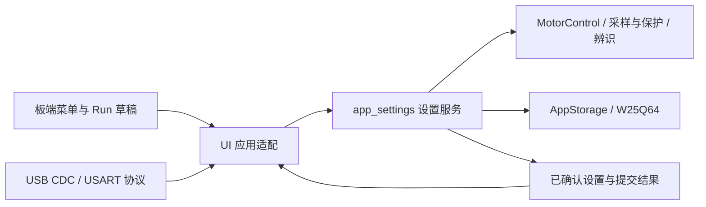

# R99：第 5 项，进一步分离设置业务与 UI

固件 **UI-R99-SET**。新增 `mycode/app_settings.c/.h`，把设置的读取归一化、校验、控制器发布、保护阈值／默认值／辨识结果及保存调度移出 `ui_app.c`。保留原有功能、菜单、字体、提示、控制准入与存储格式；无需修改 CubeMX。

## 分层

- **设置服务**：不包含 KK_UI、OLED、菜单绑定、页面 ID、提示文字或堆分配。接收明确的轴号、业务 key 与数值，统一校验／发布。设置相关的停止、型号默认值、IBUS DAC 应用、辨识结果保存及暂停／清除操作在此调用原有业务接口。
- **控制器和存储层**：继续管理运动／相位、实际准入、硬件保护、SPI2 仲裁、不可变的在途保存快照及 Flash 写入／校验。本轮不改变这些底层实现。
- **UI 适配**：保留编辑草稿、确认／取消、本地编辑冲突、提示、轴视图与 Run 页面同步。上位机标量设置不再通过临时改写 UI 绑定／调用菜单事件来校验和提交；UI 只回读提交后的结果更新显示。型号切换仍同步必要的 UI 草稿和提示。
- **协议适配**：保留原请求编号、FIFO、来源、即时 Stop 和启动动作的新鲜度检查。远程辨识的实际启动仍在临界区再次检查 `Protocol_RequestCurrent()`，然后才调用设置服务。

`App_Control()` 是 UI／协议适配入口；`AppSettings_Apply()` 才是独立的业务入口。工作模式、反馈和 Gear 的底层校验继续由原 MotorControl 公共接口执行，不再复制一套控制器。

## 业务接口

| 接口 | 职责 |
| --- | --- |
| AppSettings_ReadAxis | 按轴读取已确认设置，按旧记录规则处理限速、位置速度、步长和显示目标；读取不改写原记录 |
| AppSettings_StoreAxis | 校验类型化轴设置并发布控制选项；控制器拒绝时不写入设置 RAM |
| AppSettings_StoreTargets | 保存控制器已受理的 Speed／Uq／Position 和六步油门；不发运动命令、不保存 Iq 目标 |
| AppSettings_Apply | 沿用原 0～17 业务 key：标量设置、默认值、保护操作、辨识、暂停、保存和诊断清除 |
| AppSettings_SelectMotor | 共用型号／ESC 切换准入、停机策略及目标清零；不抢停远程持有的运行，不打断正在进行的对齐 |
| AppSettings_Changed / Input | 记录已确认修改和输入活动，参与静默保存 |
| AppSettings_SaveService / App_SaveState | 独立维护 dirty、强制保存、2 秒静默、等待总线及保存状态 |

`StoreAxis`／`StoreTargets` 是已确认值的发布原语，不隐式启动电机或提交所有 UI 变量。适配器在有效确认后调用 Changed；常规外部标量修改使用会统一标脏的 Apply。保存服务只读取已发布设置，不回调 UI 收集数据。

域参数范围与旧版保持：Speed Limit 1～600 rad/s，并受型号范围限制；Pos Speed 不大于对应 Speed Limit；三种步长 1～100 个原单位；IBUS 500～4000 mA、100 mA 一档。HSO／六步下禁止修改 M1 编码器电流环偏好，HSO 的实际 ON 与保存偏好仍分开。

对多个硬件／型号步骤组成的默认恢复和型号切换，继续沿用原控制层的顺序和拒绝机制，不宣称整个过程具备事务回滚；标量发布被拒绝时，设置 RAM 和保存请求保持原值。

## 修复与保留的行为

1. 上位机已受理的运动目标立即写入已确认设置，之后才执行页面导航；不能等到 LCD／保存动作才提交。Iq 仍不持久化。
2. 保存不会顺便提交未确认的本地草稿。修改其他轴设置成功或失败，都不重新采用当前远程运动目标、覆盖本地 Run 草稿。
3. 重建 UI 不清除 dirty／待保存计时；后台保存状态属于设置服务。无 LCD 时按实际输出请求判断停机，避免陈旧的 UI Run 标志阻止停机后的保存。
4. 重复选择相同型号保持当前运行与草稿；切换型号继续清零旧目标、保留原默认参数规则。对齐进行中拒绝换型号。
5. 本地和远程 IBUS 清除、恢复默认和诊断清除共用 UI 结果处理；主动清除 IBUS 所导致的停机不会额外制造 OUTPUT OFF 故障提示。
6. 原本地编辑框／Run Steps 的远程修改冲突拒绝、按键停止、HSO、六步、双机、辨识、首次故障记录、R98 下载期记录处理及 SPI2 延期保存均保留。

Settings 的 W25Q64 v5 结构、RPC schema 2、21 个读回字段、App key、诊断专题／行号和遥测通道不变。单文件 HTML 更新接受版本 99，保留旧版本兼容；固化在源码中的 PID 和电机预设没有新增编辑入口。

## 资源

| 构建 | R98 Flash | R99 Flash | 增加 | Flash 剩余 | RAM 总分配 |
| --- | ---: | ---: | ---: | ---: | ---: |
| Debug | 129136 B | 130232 B | 1096 B | 840 B | 29424 B |
| Release | 129136 B | 130232 B | 1096 B | 840 B | 29424 B |

本批目标是分离职责和去除 UI 对业务提交／保存的依赖，不是 Flash 压缩。完整接口与原交互接入后增加 1096 B；仍可装下，因此没有额外压缩或删除功能。RAM 总分配不变（含原有堆栈预留），未分配 3344 B；新增轴 DTO 使用栈上的短生命周期对象，保存调度状态从 UI 移入设置模块。

新增用户模块使用 `-Oz;-flto`。CMake 只增加该用户源文件及其选项；官方 HAL／LL／CMSIS／USB／HSO、Core、KK_UI／KK_OLED 核心、IOC、链接脚本及其编译选项保持 R98 基线。

## 验证与复测

- `python tests/settings_host/run.py`：仅链接真实设置服务、真实型号预设和硬件接口模型，不链接 UI、OLED 或协议。覆盖两轴限幅／位置速度联动／步长、控制器与 DAC 拒绝、地址及范围边界、HSO／六步偏好、强制／静默／在途／延期保存、旧时间戳与计时回绕、默认值、型号、辨识结果、暂停和清除。
- `python tests/ui_host/run.py`：原 UI／存储／LCD 回归；新增跨轴修改保持 Run 草稿、只保存已确认值、相同型号运行不变、IBUS 主动停止不制造故障、重建 UI 保留待保存状态，以及没有 LCD 时远程目标即时发布和停机后保存。
- `python tests/ui_host/run.py --query-baseline build/diag-query-r96/mycode/ui_app.c`：原 R95／R96 查询次数对照仍可运行；本轮未改变诊断专题内容。
- `python tests/motor_host/run.py control foc sensorless detect protocol telemetry`：真实两轴控制、FOC、HSO、辨识、协议和遥测回归；`node tests/pc_tool/test_console.js`、`python tests/pc_tool/test_wire.py` 验证单文件上位机。
- `python tests/diag_host/run.py`、`python tests/diag_host/check_arm.py --both`：真实诊断与两个实际 ELF 各 139 个异常关断、栈、保留及下载期记录场景。
- `python tests/cubemx_host/run.py`：34 项生成配置变更／DMA／KEY1 改映射回归；正常构建继续执行生成配置检查。
- `python tests/motor_host/check_startup.py`、`python tests/flash_report.py final --directory build/settings-r99 --allow-settings-user-build`：ELF／BIN 一致性及 211 个受保护文件与官方／Core 编译选项；唯一许可差异为精确的用户设置模块 CMake 增项。

Debug／Release 的 ELF、BIN、MAP 已更新，日志和 R98 基线位于忽略目录 `build/settings-r99/`。本轮尚未刷板。建议在板端和 HTML 分别修改两轴限速／步长、LED、IBUS，核对读回与断电保存；保留一个 Run 草稿时修改另一轴设置，再测试相同型号选择、恢复默认、辨识结果保存和无 LCD 通信路径。
